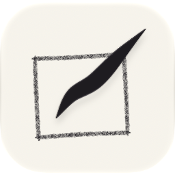

  

<h1 align="center">Inkoma</h1>

  <strong>Dessiner et animer, sur iPad</strong> · <em>Draw and animate, on iPad</em>

  
  
  
  

  <a href="https://jeromehouix.github.io/inkoma-site/"><strong>Site</strong></a> ·
  <a href="CHANGELOG.md">Nouveautés / Changelog</a> ·
  <a href="https://jeromehouix.github.io/inkoma-site/#confidentialite">Confidentialité / Privacy</a> ·
  <a href="https://github.com/jeromehouix/inkoma-site/issues/new/choose">Contact</a>

<a href="#français">Français</a> · <a href="#english">English</a>

---

## Français

Inkoma est un atelier de dessin et d'animation pour iPad. Une même feuille
sert à dessiner, à animer et à raconter en cases ; les feuilles se rangent
dans des carnets.

**Bientôt sur l'App Store.**

### Ce qu'on y fait

- **Dessiner** — plus de 190 brosses rangées par médium, un calque d'eau où
  l'aquarelle diffuse et sèche, des calques en 16 bits avec leurs modes et
  leurs masques, un atelier pour régler ses brosses.
- **Animer** — image par image avec la pelure d'oignon, le long d'une
  trajectoire, en marionnette sur un squelette, ou en stop motion avec la
  caméra de l'iPad.
- **Raconter** — un mode BD : planches, cases, bulles, onomatopées et
  trames ; votre écriture devient une police.
- **Ranger et montrer** — des carnets qui deviennent des livres en PDF, la
  lecture plein écran, l'export en vidéo, PNG, PSD et SVG.

### En bref

| | |
| --- | --- |
| Prix | Gratuit, sans achat intégré ni publicité |
| Appareil | iPad avec iPadOS 26 ; conseillé : iPad (10e génération) ou plus récent |
| Stylet | Apple Pencil ou autre stylet, avec ou sans pression ; le doigt dessine aussi |
| Langues | français, anglais, espagnol, allemand, italien, portugais, néerlandais, japonais, chinois simplifié, coréen |
| Confidentialité | Aucun compte, aucun suivi, aucune donnée collectée ; vos œuvres restent sur votre iPad |

### Nous écrire

Les formulaires s'ouvrent sur GitHub, où un compte gratuit est nécessaire
pour écrire. Les messages sont publics : n'y mettez aucune information
personnelle.

- [Poser une question](https://github.com/jeromehouix/inkoma-site/issues/new?template=question.yml)
- [Signaler un problème](https://github.com/jeromehouix/inkoma-site/issues/new?template=probleme.yml)
- [Proposer une idée](https://github.com/jeromehouix/inkoma-site/issues/new?template=idee.yml)
- [Une demande sur la confidentialité](https://github.com/jeromehouix/inkoma-site/issues/new?template=confidentialite.yml)

Voir aussi [l'aide](.github/SUPPORT.md), [comment contribuer](.github/CONTRIBUTING.md)
et [la sécurité](.github/SECURITY.md).

---

## English

Inkoma is a drawing and animation studio for iPad. The same sheet lets you
draw, animate and tell stories in panels; your sheets are kept in
sketchbooks.

**Coming soon to the App Store.**

### What you can do

- **Draw** — over 190 brushes arranged by medium, a water layer where
  watercolor spreads and dries, 16-bit layers with blend modes and masks, a
  studio to tune your brushes.
- **Animate** — frame by frame with onion skin, along a path, as a puppet on
  a skeleton, or in stop motion with the iPad's camera.
- **Tell stories** — a comic mode: pages, panels, speech balloons, sound
  effects and screentones; your handwriting becomes a font.
- **Keep and show** — sketchbooks that become PDF books, full-screen
  playback, export to video, PNG, PSD and SVG.

### At a glance

| | |
| --- | --- |
| Price | Free, with no in-app purchases or ads |
| Device | iPad with iPadOS 26; recommended: iPad (10th generation) or later |
| Stylus | Apple Pencil or another stylus, with or without pressure; your finger draws too |
| Languages | English, French, Spanish, German, Italian, Portuguese, Dutch, Japanese, Simplified Chinese, Korean |
| Privacy | No account, no tracking, no data collected; your artwork stays on your iPad |

### Get in touch

The forms open on GitHub, where a free account is needed to write. Messages
are public: do not include any personal information.

- [Ask a question](https://github.com/jeromehouix/inkoma-site/issues/new?template=question.yml)
- [Report a problem](https://github.com/jeromehouix/inkoma-site/issues/new?template=probleme.yml)
- [Suggest an idea](https://github.com/jeromehouix/inkoma-site/issues/new?template=idee.yml)
- [A privacy request](https://github.com/jeromehouix/inkoma-site/issues/new?template=confidentialite.yml)

See also [support](.github/SUPPORT.md), [contributing](.github/CONTRIBUTING.md)
and [security](.github/SECURITY.md).

---

## Ce dépôt / This repository

Ce dépôt contient le site public d'Inkoma, publié par GitHub Pages ; le code
de l'application n'est pas public. *This repository holds Inkoma's public
website, served by GitHub Pages; the app's source code is not public.*

| Fichier / File | Rôle / Purpose |
| --- | --- |
| `index.html` | La page en français : présentation, confidentialité, œuvres, conditions, mentions légales, contact / *The page in French* |
| `<langue>/index.html` | La même page dans les neuf autres langues / *The same page in the nine other languages* |
| `inkoma.png` | L'icône de l'app / *The app icon* |
| `CHANGELOG.md` | Les nouveautés de chaque version / *What's new in each version* |
| `.github/ISSUE_TEMPLATE/` | Les formulaires de contact / *The contact forms* |

Les pages sont générées depuis les textes de l'application (la page « À
propos », dans chaque langue) : on ne les modifie pas à la main. *The pages
are generated from the app's own texts and are not edited by hand.*

---

© 2026 Jérôme Houix — Inkoma. Tous droits réservés / All rights reserved
([LICENSE](LICENSE)).
